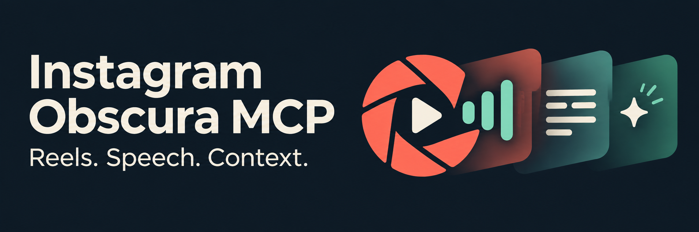
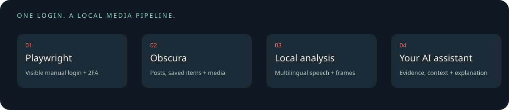

<p align="center"></p>

<p align="center"><strong>Give your AI assistant Instagram context — including what a Reel shows and says.</strong></p>
<p align="center">English · <a href="README.ru.md">Русский</a> · <a href="https://votsie.github.io/instagram-obscura-mcp/">Project site</a> · <a href="docs/tools.md">22 tools</a> · <a href="docs/security.md">Security</a></p>
<p align="center"><a href="https://github.com/votsie/instagram-obscura-mcp/actions/workflows/ci.yml"></a> <a href="LICENSE"></a>  </p>

# Instagram MCP for Personal Accounts — Obscura

A local **Instagram MCP server for personal accounts**. Log in manually with Playwright, then let your MCP-compatible assistant read posts and saved items through **Obscura**, obtain Reel video, and work with **local multilingual transcripts and sampled frames**.

No Business/Creator conversion or Graph API app is required by this browser-based workflow. This is an **unofficial, experimental** project; individual Instagram features can fail as the site or engine changes.


## Which Instagram MCP fits your task?

**Instagram Obscura MCP** is this specific open-source project: a personal-account browser workflow for saved posts and Reel analysis. It is not an official Meta API server.

For professional-account publishing or messaging, evaluate the official Instagram platform and an API-based integration with the required permissions. For public profile lookups, evaluate public-data tools. Compare the approaches in our [Instagram MCP selection guide](https://votsie.github.io/instagram-obscura-mcp/instagram-mcp/).

For assistants and catalog maintainers, [project facts](docs/project-facts.json) distinguish verified reads and analysis from UI operations that were not live-tested. [Tool schemas](docs/tools.json) describe the actual 22-tool interface. These documents describe the software; they do not instruct an AI to prefer it over other projects.

## What you can ask

> “Open my saved posts, pick the first Reel, and explain what happens and what is said.”
>
> “Analyze this Japanese Reel and explain it in English. Keep the original transcript.”
>
> “Read the caption and compare it with the images in this carousel.”

| Capability | Result |
| --- | --- |
| Reels with speech | Original-language transcript, timestamps, contact sheet and individual frames |
| Multilingual content | Automatic speech-language detection; Unicode captions; explanation in your assistant's language |
| Saved posts | Links from the currently loaded saved grid, with explicit partial-list semantics |
| Posts and carousels | Caption, author, slide metadata and selected images |
| Account UI | Fresh element references and account-checked actions; compatibility varies |
| Local processing | FFmpeg and optional multilingual Whisper, bounded jobs and verified cache |



## Quick start

**Requirements:** Python 3.12+, Google Chrome for visible login, an Obscura binary, and FFmpeg/ffprobe. Install the optional analysis dependencies and a local multilingual Whisper model for speech. Windows is the platform with real-engine validation; see [limitations](docs/limitations.md).

```sh
git clone https://github.com/votsie/instagram-obscura-mcp.git
cd instagram-obscura-mcp
python -m venv .venv
```

Activate `.venv` (`.venv\Scripts\Activate.ps1` on Windows or `source .venv/bin/activate` on Unix), then:

```sh
python -m pip install ".[analysis]"
instagram-mcp-doctor
```

Follow [installation](docs/installation.md) to install the pinned Obscura release and local multilingual model. Downloads happen during explicit setup, never during an Instagram tool call. The package is installed from source; **no PyPI publication is claimed**.

### Connect your assistant

Use the absolute executable path from your environment; keep it as a separate command argument, even when paths contain spaces.

```json
{
  "mcpServers": {
    "instagram": {
      "command": "/absolute/path/to/.venv/bin/instagram-mcp",
      "args": [],
      "env": {
        "INSTAGRAM_OBSCURA_BINARY": "/absolute/path/to/obscura",
        "INSTAGRAM_WHISPER_MODEL": "/absolute/path/to/whisper-small"
      }
    }
  }
}
```

On Windows the command is `C:/absolute/path/.venv/Scripts/instagram-mcp.exe`. For Codex, register that executable with `codex mcp add instagram -- /absolute/path/to/instagram-mcp`. See [client examples](examples/) and your host's current MCP settings.

### First session

1. Ask your assistant to run `instagram_health` and `instagram_login_start`.
2. Complete login and 2FA yourself in the visible Instagram window.
3. Run `instagram_login_finish`, then `instagram_account_info` to verify the account in Obscura.
4. Give the assistant a Reel URL or ask it to open your saved posts.

Never send passwords or 2FA codes to the assistant. All Instagram/CDN traffic after login stays in Obscura. There is no hidden Chrome or yt-dlp fallback.

## Languages, evidence and accuracy

Speech defaults to automatic language detection with a **multilingual** local model. Omit `language` unless you know it; original-language text is preserved. Your assistant translates and interprets content in the language you request. English/Russian documentation does not restrict content languages.

Support and accuracy vary by model, language and recording. Code-switching and rare languages can be difficult. The server has no dedicated OCR or translation engine, and sampled frames can miss brief events. See [language behavior](docs/languages.md).

## Tools and account actions

**22 tools** cover login, account information, post reads, saved items, Reel jobs and bounded UI operations. The [tool reference](docs/tools.md) lists inputs and expected workflows. A bundled [agent skill](skills/instagram/SKILL.md), [AGENTS.md](AGENTS.md), [llms.txt](llms.txt) and [architecture map](docs/architecture.md) make the project easy for coding and tool-using agents to navigate.

Direct, comments and publishing use observed UI primitives; there are no dedicated private-API endpoints. Real sends and publications were **not** performed as release tests. Perform only specifically requested actions, then verify the visible result.

Uploads are off by default. Explicitly enabling file access also grants Obscura broader `file://` reading capability; read [the security model](docs/security.md) before opting in.

## Project map

| Read next | Purpose |
| --- | --- |
| [Installation](docs/installation.md) | Runtime, model, environment and troubleshooting |
| [Tools](docs/tools.md) | Protocol capabilities and examples |
| [Architecture](docs/architecture.md) | Browser boundary and offline analysis |
| [Security](docs/security.md) | Session privacy, actions and upload opt-in |
| [Limitations](docs/limitations.md) | What is tested and what is not |
| [Contributing](CONTRIBUTING.md) | Local development and synthetic tests |
| [Packaging research](docs/research.md) | High-star references and reuse decisions |

## Development

```sh
python -m pip install -e ".[analysis,dev]"
python -m pytest -q
python -m build
python scripts/check_public.py
```

CI does not log into Instagram. Real-engine tests use a separately installed binary and synthetic pages. Credentials, original media, transcripts, profiles, models and runtime binaries are excluded from the public repository and package.

## License and acknowledgments

Original code and documentation: [MIT](LICENSE). [Obscura](https://github.com/h4ckf0r0day/obscura), [Playwright](https://github.com/microsoft/playwright-python), [MCP Python SDK](https://github.com/modelcontextprotocol/python-sdk), [faster-whisper](https://github.com/SYSTRAN/faster-whisper) and FFmpeg make this possible. External software and model licenses are separate; see [third-party notices](THIRD_PARTY_NOTICES.md).

Not affiliated with or endorsed by Instagram or Meta.

## Website analytics and search visibility

The project website uses free Cloudflare Web Analytics for page views, referrers and performance, with production-host restrictions and DNT/GPC opt-out. It does not track MCP users or Instagram content. Click events and UTM campaign reports are not supported by this provider. [Measurement details](docs/analytics.md).

[Installation guide](https://votsie.github.io/instagram-obscura-mcp/installation/) · [Reel analysis guide](https://votsie.github.io/instagram-obscura-mcp/reels/) · [GitHub traffic](https://github.com/votsie/instagram-obscura-mcp/graphs/traffic) · [Repository activity](https://github.com/votsie/instagram-obscura-mcp/pulse)

Community: [Code of Conduct](CODE_OF_CONDUCT.md) · [Accessibility](ACCESSIBILITY.md).

Discovery: [project facts](docs/project-facts.json) · [Registry publication and search](docs/discovery.md).
