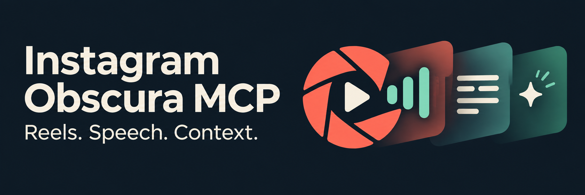
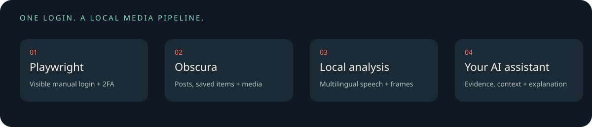

<p align="center"></p>
<p align="center"><strong>Дайте ИИ контекст из Instagram: что видно в Reel и что в нём говорят.</strong></p>
<p align="center"><a href="README.md">English</a> · Русский · <a href="https://votsie.github.io/instagram-obscura-mcp/ru/">Сайт проекта</a> · <a href="docs/tools.md">22 инструмента</a></p>

# Instagram Obscura MCP

Локальный **Instagram MCP для обычного личного аккаунта**. Вы входите вручную через Playwright, а затем ИИ читает посты и сохранённое через **Obscura**, получает видео Reels и использует **локальную многоязычную расшифровку и кадры**.

Этот браузерный сценарий не требует перевода аккаунта в Business/Creator или приложения Graph API. Проект **неофициальный и экспериментальный**: конкретные функции могут перестать работать после изменений Instagram или движка.

## Что можно поручить

> «Открой сохранённое, выбери первый Reel и объясни, что происходит и что говорят».
>
> «Разбери японский Reel по-русски и сохрани транскрипт на языке оригинала».
>
> «Прочитай подпись и сравни её с изображениями карусели».

| Возможность | Результат |
| --- | --- |
| Reels со звуком | Транскрипт на языке оригинала, таймкоды, обзорный лист и отдельные кадры |
| Разные языки | Автоопределение языка речи, Unicode-текст; объяснение на языке запроса |
| Сохранённое | Ссылки из загруженной части сетки; это не гарантированный полный архив |
| Посты и карусели | Подпись, автор, данные слайдов и изображения |
| Действия в аккаунте | Свежие ссылки на элементы и проверка аккаунта; совместимость зависит от интерфейса |
| Локальный анализ | FFmpeg, многоязычная Whisper, ограниченная очередь и проверяемый кеш |



## Быстрый старт

Нужны Python 3.12+, Google Chrome для ручного входа, бинарник Obscura и FFmpeg/ffprobe. Для речи — зависимости analysis и локальная многоязычная Whisper. С настоящим движком проверена Windows; другие платформы требуют отдельной проверки.

```sh
git clone https://github.com/votsie/instagram-obscura-mcp.git
cd instagram-obscura-mcp
python -m venv .venv
```

Активируйте окружение: `.venv\Scripts\Activate.ps1` в Windows или `source .venv/bin/activate` в Unix.

```sh
python -m pip install ".[analysis]"
instagram-mcp-doctor
```

[Инструкция по установке на русском](docs/ru/installation.md) описывает Obscura, модель и подключение клиента. Загрузки выполняются только при явной установке, не во время обращения к Instagram. Публикация пакета в PyPI не заявляется.

Пример конфигурации MCP (пути замените своими):

```json
{
  "mcpServers": {
    "instagram": {
      "command": "C:/absolute/path/.venv/Scripts/instagram-mcp.exe",
      "args": [],
      "env": {
        "INSTAGRAM_OBSCURA_BINARY": "C:/absolute/path/obscura.exe",
        "INSTAGRAM_WHISPER_MODEL": "C:/absolute/path/whisper-small"
      }
    }
  }
}
```

В Unix используйте абсолютный путь `.venv/bin/instagram-mcp`. Для Codex: `codex mcp add instagram -- /absolute/path/to/instagram-mcp`.

## Первый вход и разбор

1. Попросите ИИ вызвать `instagram_health`, затем `instagram_login_start`.
2. Самостоятельно введите пароль и 2FA в открытом окне Instagram.
3. Вызовите `instagram_login_finish`, затем `instagram_account_info` для проверки аккаунта через Obscura.
4. Передайте ссылку на Reel или попросите открыть сохранённое.

Не отправляйте пароль и коды в чат. После входа весь трафик Instagram/CDN идёт через Obscura; скрытого перехода на Chrome или yt-dlp нет.

## Языки и точность

Язык речи определяется автоматически. Если он известен, можно указать поддерживаемый код явно. Нужна **многоязычная модель**, а не `.en`. Текст сохраняется в оригинале; перевод и объяснение выполняет ИИ-клиент на нужном языке.

Поддержка буквально каждого языка не гарантируется. Точность зависит от модели, записи и языка; смешанная речь, диалекты, имена и числа требуют проверки. Выборочные кадры могут пропустить короткое событие. Отдельного OCR или переводчика в сервере нет. [Подробнее](docs/ru/guide.md).

## Действия и безопасность

Direct, комментарии и публикация работают через интерфейсные примитивы, без специальных private API. Реальные отправки и публикации не выполнялись как тесты выпуска. Поручайте конкретное действие и проверяйте видимый результат.

Прикрепление файлов по умолчанию выключено. Явное разрешение включает также более широкий доступ движка к `file://`; перед включением прочитайте [модель безопасности](docs/ru/security.md). Профиль и результаты сохраняются локально; cookies хранятся в открытом виде внутри каталога с ограниченными правами.

## Документация и разработка

- [Установка](docs/ru/installation.md), [руководство и ограничения](docs/ru/guide.md), [безопасность](docs/ru/security.md).
- [Каталог инструментов EN/RU](docs/tools.md), [архитектура](docs/architecture.md), [навык ИИ](skills/instagram/SKILL.md), [llms.txt](llms.txt).
- [Участие в проекте](CONTRIBUTING.md), [исследование популярных репозиториев](docs/research.md).

```sh
python -m pip install -e ".[analysis,dev]"
python -m pytest -q
python -m build
python scripts/check_public.py
```

CI использует синтетические данные и не входит в Instagram. Сессии, видео, реальные транскрипты, модели и бинарники не входят в публичную поставку.

Свой код и документация — [MIT](LICENSE). Лицензии зависимостей учитываются [отдельно](THIRD_PARTY_NOTICES.md). Проект не связан с Meta и не является официальным продуктом Instagram.
