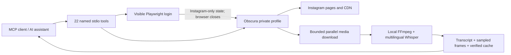

# Architecture

The assistant interprets frames and text. The MCP server does not call a paid vision or translation API and does not claim to watch every video frame. Login requires a person to complete credentials, 2FA or challenges in the visible browser.

Obscura control is loopback-only with an ephemeral token. One process owns a profile at a time. Completed jobs persist with integrity-checked artifacts; active work is bounded and cancelled during shutdown. No always-on service is installed.

Reads use exact post identifiers. UI actions use observed, expiring references and account verification. There are no dedicated private-API DM/publish endpoints: complex actions depend on the interface and engine compatibility.

See [security](security.md), [languages](languages.md), [tools](tools.md) and [limitations](limitations.md).
